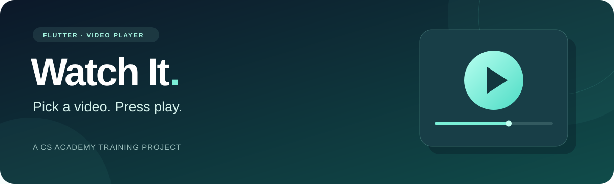

<p align="center">
  
</p>

<h1 align="center">🎬 Watch It — Flutter Video Player</h1>

<p align="center">
  A little video library. One tap to start watching.<br />
  Built during the <strong>Flutter Training Bootcamp at CS Academy</strong>.
</p>

<p align="center">
  
  
  
  
</p>

<p align="center">
  <a href="#about">About</a> ·
  <a href="#screenshots">Screenshots</a> ·
  <a href="#features">Features</a> ·
  <a href="#learning">Learning Experience</a> ·
  <a href="#tech-stack">Tech Stack</a> ·
  <a href="#getting-started">Getting Started</a>
</p>

---

<a id="about"></a>

## 🍿 About the App

**Watch It** is a simple Flutter app for browsing and watching YouTube videos. It was built during the **Flutter Training Bootcamp at CS Academy** to practice video playback and navigation.

<a id="screenshots"></a>

## 📱 A Look Inside

From choosing a video to pressing play:

<table>
  <tr>
    <th align="center" width="50%">🎞️ Your Video Library</th>
    <th align="center" width="50%">▶️ Time to Watch</th>
  </tr>
  <tr>
    <td align="center">
      <a href="docs/screenshots/video-library.jpeg"></a>
    </td>
    <td align="center">
      <a href="docs/screenshots/video-player.jpeg"></a>
    </td>
  </tr>
  <tr>
    <td align="center">Browse the list and choose what to watch.</td>
    <td align="center">Play, pause, seek, and switch to fullscreen.</td>
  </tr>
</table>

<a id="features"></a>

## ✨ Key Features

- 🎬 Browse a simple video library.
- ▶️ Watch YouTube videos inside the app.
- ⏯️ Play, pause, and skip to any point in a video.
- ⛶ Switch to fullscreen.
- 🧭 Move easily between the library and player.

<a id="learning"></a>

## 📚 Learning Experience

What I practiced:

- Building simple Flutter screens.
- Adding video playback.
- Navigating between screens.
- Organizing code and handling playback errors.

<a id="tech-stack"></a>

## 🛠️ Tech Stack

| Purpose | Technology |
| :--- | :--- |
| UI & Language | Flutter, Dart |
| Interface | Material Design |
| YouTube Playback | `youtube_player_flutter` |
| Training Package | `video_player` |
| Navigation | Flutter Navigator |

The current app uses `youtube_player_flutter`; `video_player` was part of the training exercise.

<a id="getting-started"></a>

## 🚀 Getting Started

Install Flutter with Dart `^3.10.4`, connect a supported device, and run these commands from the project folder:

```bash
flutter pub get
flutter run
```

Or run in Chrome:

```bash
flutter run -d chrome
```

Video playback requires internet and works on **Android, iOS, macOS, and web**. Windows and Linux show a message instead of the player.

## 🎞️ Make the Library Yours

The home screen loads `playlists`; opening a playlist loads its linked rows from `youtube_videos`.
Create both tables and their policies using [supabase_tafra_setup.sql](docs/supabase_tafra_setup.sql).
Teachers can sign in, select an existing playlist or create one while saving a YouTube link, and delete videos. The SQL file also includes the atomic save function used by Flutter.
The app shows an empty library when the table has no videos, and an error message if Supabase is not configured.

## 🗂️ Project Structure

```text
lib/
├── main.dart               # App entry point
├── e_learning.dart         # App setup
├── core/                   # Shared settings, theme, and navigation
└── features/videos/        # Video data and screens

docs/screenshots/           # App screenshots
```

---

<p align="center">
  
</p>

<p align="center">
  <strong>Built with Flutter. Made for learning.</strong><br />
  A training project by <a href="https://github.com/ReemMohsn">ReemMohsn</a><br />
  Flutter Training Bootcamp · CS Academy
</p>
