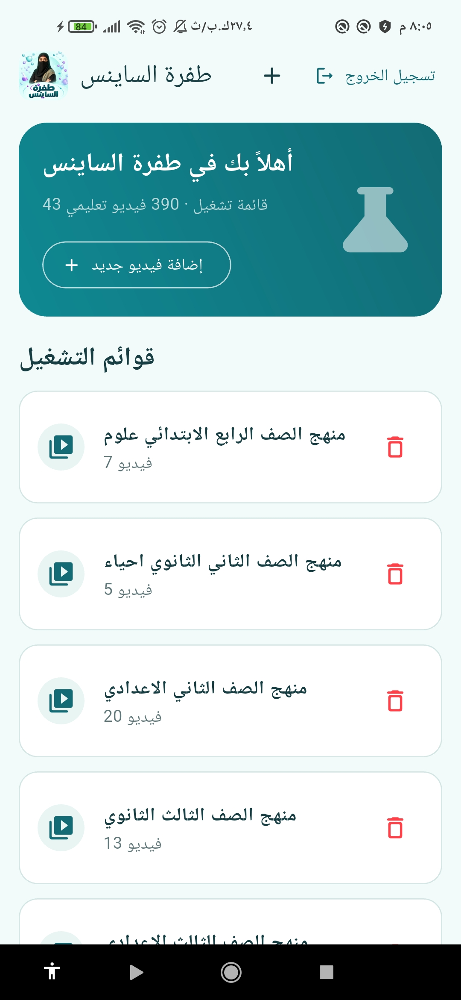
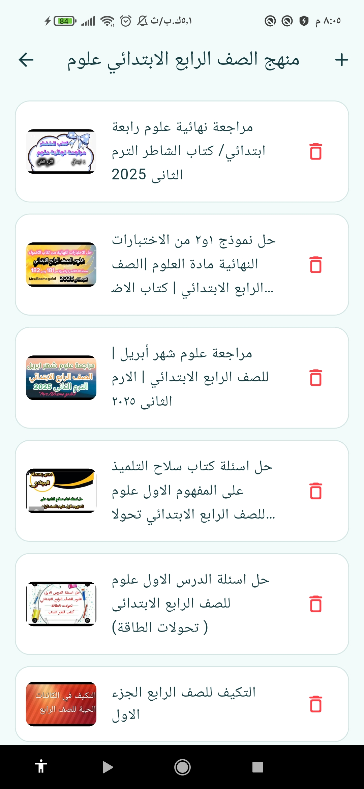
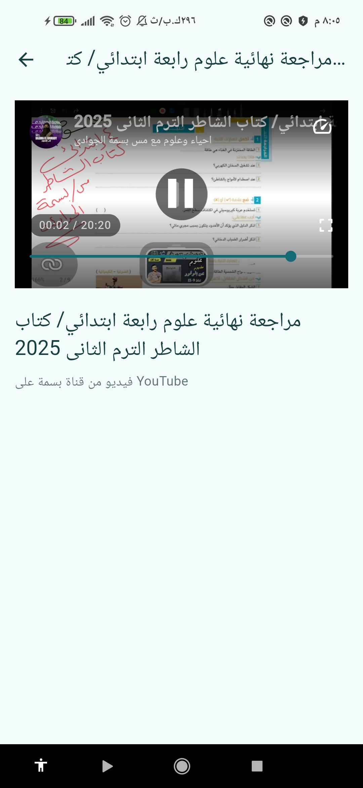
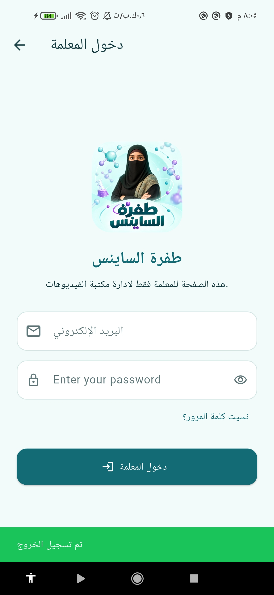
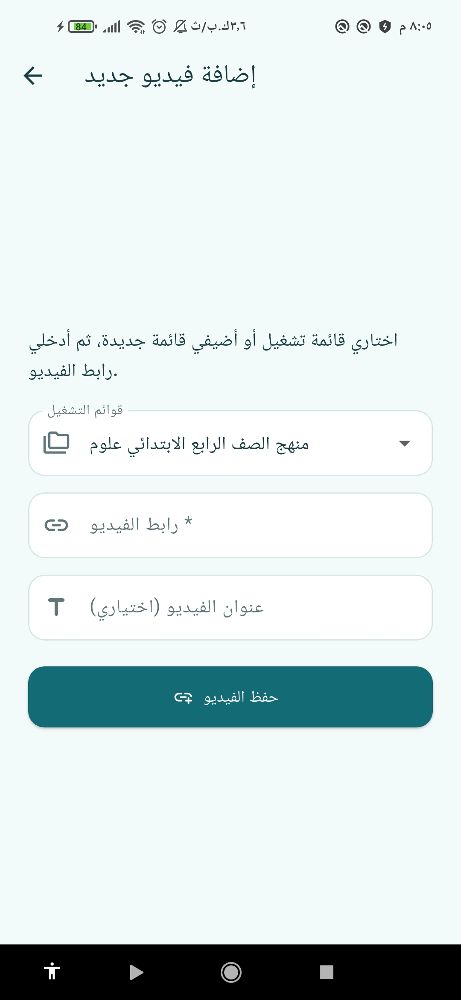
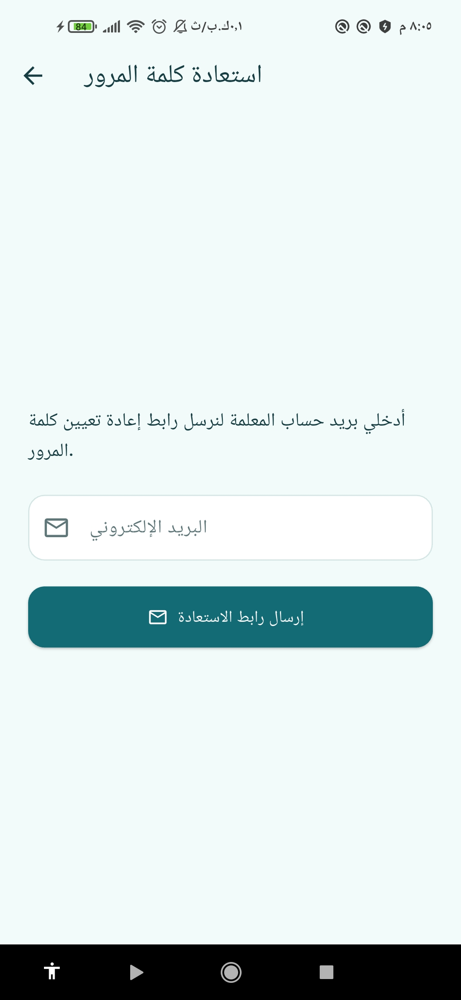
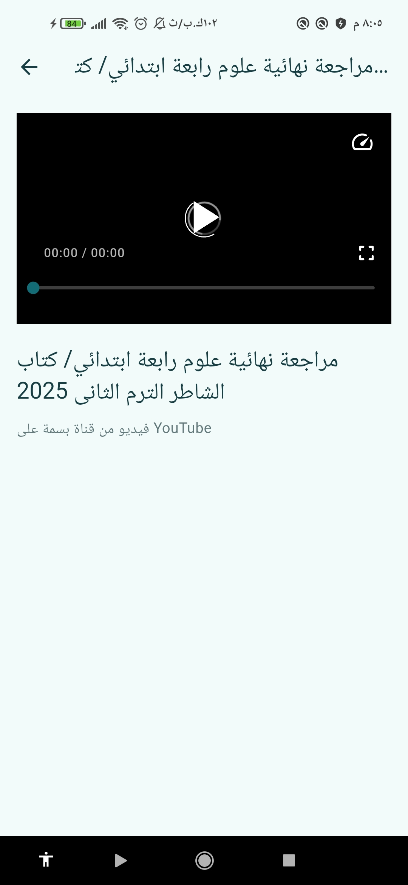
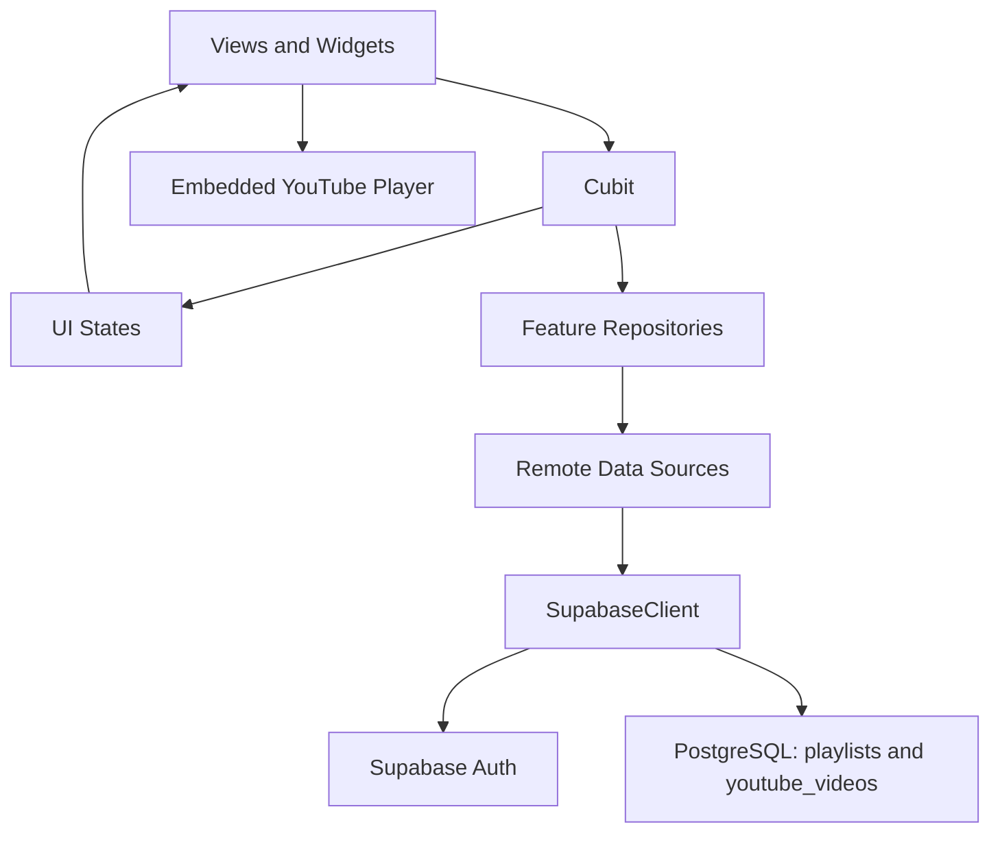

<p align="center">
  
</p>

<h1 align="center">🧪 Tafrah Science — طفرة الساينس</h1>

<p align="center">
  An Arabic educational video library, customized for a real teacher.<br />
  Built during the <strong>Flutter training program at CS Academy</strong>.
</p>

<p align="center">
  
  
  
  
  
</p>

<p align="center">
  <a href="#about">About</a> ·
  <a href="#features">Features</a> ·
  <a href="#learning">Learning Experience</a> ·
  <a href="#screenshots">Screenshots</a> ·
  <a href="#architecture">Architecture</a> ·
  <a href="#tech-stack">Tech Stack</a> ·
  <a href="#getting-started">Getting Started</a>
</p>

---

<a id="about"></a>

## 🧪 About the App

**Tafrah Science (طفرة الساينس)** is a Flutter application that brings a teacher's educational YouTube videos together in a dedicated library. Learners can browse playlists organized by school grade and subject, open a lesson, and watch it inside the app without signing in.

The project was developed as part of the **Flutter training program at CS Academy**. One of the training requirements was to work with a **real client** and customize an application for their needs. For this project, the app was tailored to a science teacher, using the **طفرة الساينس** identity, logo, colors, Arabic interface, and educational content.

The current version includes a Supabase-backed playlist library and a teacher management flow for adding YouTube links, creating playlists, deleting content, and recovering the teacher account password.

<a id="features"></a>

## ✨ Key Features

- 🏠 **Public Video Library** — Browse playlists and watch lessons without creating a learner account.
- 📚 **Playlist Browsing** — Open a playlist to view its lessons with titles and YouTube thumbnails, and pull to refresh the library or lesson list.
- 🎬 **YouTube Playback** — An embedded player with play, pause, seeking, fullscreen controls, and playback error feedback.
- 🔐 **Teacher Login** — Email and password authentication through Supabase Auth, with form validation, password visibility controls, and logout. Management buttons appear after signing in.
- ➕ **Add Videos & Playlists** — Save a YouTube link to an existing playlist or create a new playlist while adding the video. The video title is optional, and links are validated before saving.
- 🗑️ **Content Management** — Delete individual video records or confirm deletion of a playlist and all its linked video records from the app library.
- 📧 **Password Recovery** — Request a reset link by email, return to the app through an authentication callback, and set and confirm a new password.
- 💬 **Request Feedback** — Loading indicators, empty states, retry actions, and Arabic success and error messages for library and account operations.

<a id="learning"></a>

## 📚 Learning Experience

The project provided practical experience with:

- Working with a real client as part of a training assignment and adapting the app's identity and content management flow to the client's needs.
- Building Flutter screens with reusable widgets, shared styling, forms, and layouts constrained for different screen widths.
- Managing authentication, playlist, and video state with **Cubit**, `BlocBuilder`, `BlocListener`, and `BlocConsumer`.
- Connecting **Supabase Auth** and **PostgreSQL** to a Flutter application.
- Converting backend responses into Dart models and separating views, state logic, repositories, and remote data sources by feature.
- Registering dependencies and creating Cubits with **GetIt**.
- Handling request results with **Dartz** `Either<Failure, T>` and shared error mapping.
- Fetching playlist and video data in pages, displaying related video counts, and refreshing the UI after content changes.
- Validating YouTube links, managing the player controller lifecycle, and providing feedback when playback fails.
- Handling password recovery links with **app_links**, Supabase authentication events, and the PKCE recovery flow.
- Using a database RPC to save a new playlist and video together, and a cascading relationship to delete a playlist with its linked records.

<a id="screenshots"></a>

## 📱 Screenshots

Screens from the current app. Select any screenshot to view it at full size. The management controls shown in the library screenshots are visible to the signed-in teacher.

<table>
  <tr>
    <td align="center" width="33%">
      <a href="docs/screenshots/home-playlists.jpeg"></a>
      <br /><b>Home & Playlists</b>
    </td>
    <td align="center" width="33%">
      <a href="docs/screenshots/playlist-videos.jpeg"></a>
      <br /><b>Playlist Videos</b>
    </td>
    <td align="center" width="33%">
      <a href="docs/screenshots/video-playback.jpeg"></a>
      <br /><b>Video Playback</b>
    </td>
  </tr>
  <tr>
    <td align="center" width="33%">
      <a href="docs/screenshots/teacher-login.jpeg"></a>
      <br /><b>Teacher Login</b>
    </td>
    <td align="center" width="33%">
      <a href="docs/screenshots/add-video.jpeg"></a>
      <br /><b>Add Video</b>
    </td>
    <td align="center" width="33%">
      <a href="docs/screenshots/password-recovery.jpeg"></a>
      <br /><b>Password Recovery</b>
    </td>
  </tr>
  <tr>
    <td align="center" colspan="3">
      <a href="docs/screenshots/video-player.jpeg"></a>
      <br /><b>Video Player</b>
    </td>
  </tr>
</table>

<a id="architecture"></a>

## 🏛️ App Architecture

The codebase follows a **feature-based structure**. Authentication, playlists, and videos each separate data access from presentation, while `core` provides dependency injection, Supabase initialization, routing, themes, validation, and shared error handling.



**GetIt** supplies data sources, repositories, and Cubits. Repository requests pass through a shared `requestHandler` and return either a `Failure` or a successful result. Supabase stores playlist and video metadata; playback streams the videos from **YouTube**.

### Project Structure

```text
lib/
├── main.dart                  # Application entry point and initialization
├── e_learning.dart            # Material app and authentication listener
├── core/
│   ├── common/                # Form validation and YouTube URL parsing
│   ├── config/                # Local Supabase configuration (gitignored)
│   ├── constants/             # Shared strings, images, and preference keys
│   ├── dependency_injection/  # GetIt registrations
│   ├── extensions/            # Screen and snackbar helpers
│   ├── networking/            # Supabase initialization
│   ├── routing/               # Routes and navigator key
│   ├── services/              # Request handling, errors, and preference helper
│   └── themes/                # Colors and Material theme
└── features/
    ├── auth/                  # Teacher login and password recovery
    ├── playlists/             # Playlist loading, counts, and deletion
    └── videos/                # Lesson lists, adding, deletion, and playback

assets/branding/               # Client app logo
docs/screenshots/              # App screenshots
docs/                         # Backend migration and teacher setup guide
```

Each feature groups models, remote data sources, and repositories in `data`, and views, widgets where needed, and Cubits in `presentation`.

<a id="tech-stack"></a>

## 🛠️ Tech Stack

| Purpose | Technology |
| :--- | :--- |
| UI & Language | Flutter, Dart |
| State Management | Cubit / `flutter_bloc` |
| Authentication | Supabase Auth |
| Database | Supabase PostgreSQL, database RPC |
| YouTube Playback | `youtube_player_flutter` |
| Authentication Links | `app_links`, Supabase PKCE |
| Dependency Injection | `get_it` |
| Result Handling | `dartz` / `Either` |
| Navigation | Flutter Navigator with named routes |
| Styling | Material 3, shared light theme |
| Native Splash | `flutter_native_splash` |

Package versions are listed in [pubspec.yaml](pubspec.yaml).

<a id="getting-started"></a>

## 🚀 Getting Started

### Prerequisites

- Flutter with Dart `>=3.10.4 <4.0.0`.
- Git and an editor such as VS Code or Android Studio.
- An Android emulator or connected device. For iOS, use macOS and Xcode.
- An internet connection for dependencies, Supabase requests, thumbnails, and YouTube playback.
- Access to a Supabase project configured for the playlist library and teacher accounts.

### Run Locally

```bash
git clone https://github.com/ReemMohsn/watch_it.git
cd watch_it
flutter pub get
```

Use `flutter doctor` to check your setup and `flutter devices` to list available devices.

### Supabase Configuration

Create `lib/core/config/supabase_config.dart`, which is excluded from version control, with your project's connection values:

```dart
abstract final class SupabaseConfig {
  static const url = 'https://YOUR_PROJECT.supabase.co';
  static const key = 'YOUR_SUPABASE_PUBLISHABLE_KEY';
}
```

[SupabaseService](lib/core/networking/supabase_service.dart) reads these values during app initialization. Use a client publishable key; keep service-role and secret keys out of the app.

### Backend & Teacher Setup

The current Flutter code expects the following backend contract:

| Resource | Expected data or behavior |
| :--- | :--- |
| `playlists` | `id`, `name`; related video counts through `youtube_videos` |
| `youtube_videos` | `id`, `playlist_id`, `youtube_id`, `title`, `thumbnail_url`, `position`, `created_at` |
| `add_youtube_video` RPC | Accepts `p_youtube_id`, `p_title`, `p_playlist_id`, and `p_new_playlist_name`; saves the video and, when requested, a new playlist in one transaction |
| Access policies | Public library reads and authenticated teacher management |

The repository includes an **update for an existing backend**, [supabase_playlist_deletion.sql](docs/supabase_playlist_deletion.sql). It enables authenticated playlist deletion and sets the video relationship to `ON DELETE CASCADE`. The initial table schema, read/write policies, and `add_youtube_video` function definition are not included; configure those resources before connecting a new Supabase project.

Create the teacher account in **Supabase Auth**. The app provides teacher login and password recovery; it has no public account registration screen. The current management flow treats signed-in accounts as teachers, so provision accounts accordingly.

Follow the [teacher setup and password recovery guide (Arabic)](docs/teacher_account_setup.md) to apply the deletion migration and configure recovery redirects. Native callbacks use `tafrah-science://auth-callback/`; web recovery uses the current app URL. Open the reset link on the same device and browser, where applicable, that requested it.

After configuration, launch the app:

```bash
flutter run
```

Or run the web version:

```bash
flutter run -d chrome
```

The current player is enabled on **Android, iOS, macOS, and web**. Windows and Linux display a platform message in place of the player. Native password recovery callbacks are configured for Android, iOS, and macOS; use the web version for recovery on Windows and Linux.

### Using the App

1. Open the home screen, choose a playlist, and select a lesson to watch.
2. To manage the library, select **تسجيل الدخول** and sign in with the teacher account.
3. Select **إضافة فيديو جديد**, choose an existing playlist or enter a new playlist name, paste a YouTube link, optionally add a title, and save.
4. Use the delete controls to remove a video or a playlist from the library. Deleting a playlist asks for confirmation and removes its linked video records.
5. From the login screen, select **نسيت كلمة المرور؟** to request an email reset link when needed.

## 👩‍💻 Author

[ReemMohsn](https://github.com/ReemMohsn)

Built during the Flutter training program at **CS Academy**, with real-client collaboration and customization for **طفرة الساينس**.
